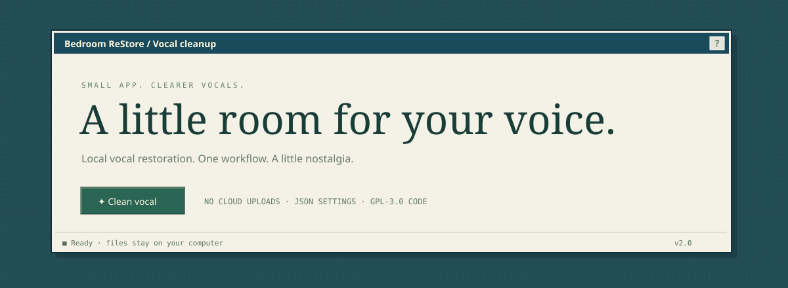

<p align="center"></p>

<p align="center"><strong>Drop a vocal. Clean it. Compare it. Keep the good take.</strong><br>A local audio tool with an early-2000s soul.</p>

<p align="center"><a href="#get-started">Get started</a> · <a href="docs/workflow.md">The workflow</a> · <a href="docs/configuration.md">Configuration</a> · <a href="docs/models.md">Models & licenses</a></p>

Restore brings a fixed vocal cleanup chain into a small, quiet browser interface. It removes the node editor and puts tuning in one JSON file. Processing runs on your own computer; there is no account, cloud upload, telemetry, or API key in the app.

**The code is open source; the complete studio setup is not a free plugin bundle.** The default profile requires licensed Nectar 4, Waves X-Click, and soothe2. Both shipped profiles currently use a Sucial model labelled **CC BY-NC-SA 4.0 (non-commercial)**. Model weights and plugins are not included. Review [model terms](docs/models.md) before paid or monetized work; this release does not establish commercial permission for that model.

## What it does

- One fixed workflow: noise → echo → breaths → mouth clicks → gentle finish → export.
- Drag and drop, real waveform preview, and synchronized Before / Cleaned playback.
- 24-bit WAV and 320 kbps MP3 downloads at the original duration, channel count and sample rate.
- Saved stages, Resume after interruptions, explicit errors, and one recording at a time.
- Local CPU inference. No GPU subscription, Streamlit, Audacity, or external audio service.
- A small optional AudioJS click-repair engine. It is fast and locally executed, but **not validated as an equivalent replacement for X-Click on singing**.

Built for isolated vocals, singing and voice recordings. It is not an instrument separator, pitch corrector, or a guarantee that every breath/click can be removed without touching an intended consonant.

## Get started

**Tested:** Windows, Python 3.13, CPU. Other platforms are unverified. A modern multi-core CPU and 16 GB RAM are recommended. The three separator weights total about 2.66 GB; allow additional disk space for Python dependencies and saved audio stages.

1. Install Python 3.13 and FFmpeg (including `ffprobe`) on PATH. Clone or extract this source release.
2. Set up Python:

   ```powershell
   python -m venv .venv
   .\.venv\Scripts\python -m pip install torch==2.13.0 --index-url https://download.pytorch.org/whl/cpu
   .\.venv\Scripts\python -m pip install -r requirements.txt
   ```

3. Install and activate your own studio VST3 plugins. Update their paths in `config.json`, or use a private `.config.local.json` override. See [configuration](docs/configuration.md) for the optional portable profile.
4. Read the [external model terms](docs/models.md), then download the configured models:

   ```powershell
   .\.venv\Scripts\python setup_models.py
   ```

5. Double-click **Start Restore.cmd**, or run:

   ```powershell
   .\.venv\Scripts\python restore.py
   ```

The app opens at `http://127.0.0.1:8530`. Pick a mono/stereo WAV, MP3, FLAC, M4A, OGG or AIFF file (16–96 kHz, 1 second–30 minutes, up to 512 MB). Click **Clean vocal**, then compare and download. The Python window must remain open; the browser tab can be closed and reopened.

If a dependency is missing, Restore lists it before processing. It never silently changes the workflow or downloads weights during cleanup.

## Your configuration, your recordings

Edit `config.json` and restart the app. Stage order is fixed in code. `.config.local.json` merges into the public defaults and is ignored by Git; use it for machine-specific paths. Each recording saves a frozen configuration and a source-bound receipt, so Resume uses the same settings as the original run.

All work stays in `output/jobs` by default. You retain your original upload, decoded WAV, intermediate stages, final WAV/MP3, logs and timing receipts. Remove completed job folders yourself when no longer needed. Never upload private recordings in a bug report.

## How fast is it?

The interface is light; the separation models are not. CPU speed varies with clip length, plugin startup, memory pressure and other work on the machine. A fresh 8-second Windows studio smoke test took **5 min 24 sec** including startup/export; this is a functional test, not a throughput benchmark. A prior 40-second recording took about 20 minutes on the same setup. There is no per-recording API charge in the normal app.

Receipts record stage wall time, CPU core-seconds and the largest observed process memory peak. They include isolated aspiration/X-Click worker CPU, but exclude FFmpeg child CPU and do not measure the whole system's simultaneous peak. See [validation](docs/validation.md).

## Development

The UI is vanilla HTML/CSS/JavaScript. The server uses Python's standard library and binds only to loopback. Each recording gets a fresh worker process, with an isolated aspiration worker before native ONNX/VST hosting.

```powershell
python -m pip install -r requirements-test.txt
npm ci --prefix vendor/audiojs --ignore-scripts
npm run lint
npm test
npm run build
```

Use `RESTORE_PYTHON` to select a Python environment. Set `RESTORE_NATIVE_TESTS=1` for tests requiring installed studio plugins and detector weights. The source build is an allowlisted ZIP in `dist`; it excludes recordings, dependencies, model weights, local settings and plugin binaries.

See [CONTRIBUTING.md](CONTRIBUTING.md), [architecture](docs/architecture.md), and [SECURITY.md](SECURITY.md). Changes to breath/click processing need a controlled listening comparison as well as numerical preservation checks.

## Credits & license

Restore code: **GPL-3.0-only**. Thanks to PyMSS and the model authors, Respiro, DawDreamer, Pedalboard, AudioJS, NumPy, SciPy, librosa and SoundFile. See [THIRD_PARTY_NOTICES.md](THIRD_PARTY_NOTICES.md) for upstream links and separate terms. No affiliation with or endorsement by plugin vendors is implied.
