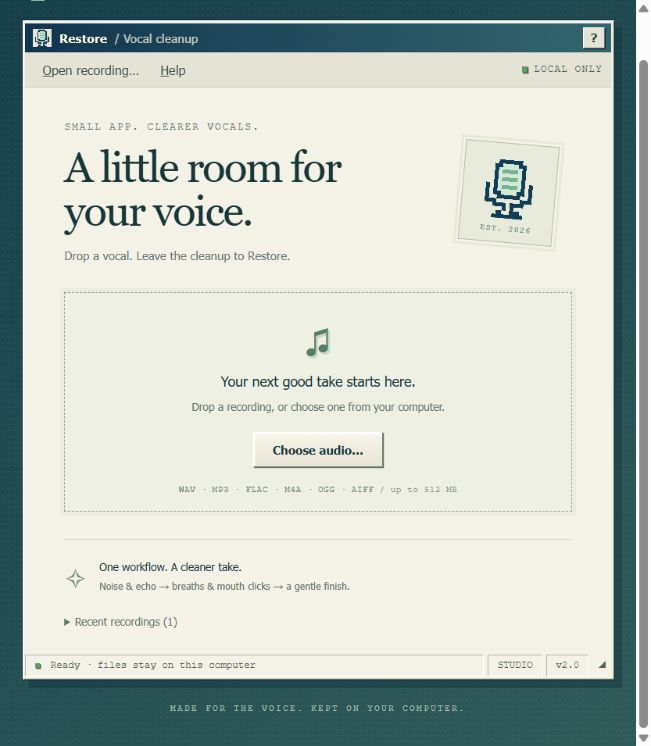
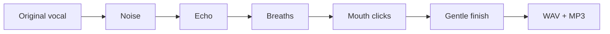

<p align="center"></p>

<h1 align="center">Restore</h1>

<p align="center"><strong>A little room for your voice.</strong><br>Local vocal cleanup, one repeatable workflow, and an early-2000s interface.</p>

<p align="center">
  <a href="https://github.com/ashutosh0sharma1/VocalRestore/actions/workflows/checks.yml"></a>
  <a href="https://github.com/ashutosh0sharma1/VocalRestore/releases/latest"></a>
  <a href="LICENSE"></a>
</p>

<p align="center"><a href="#get-started">Get started</a> · <a href="#what-you-get-for-free">What's free</a> · <a href="docs/workflow.md">The workflow</a> · <a href="docs/faq.md">FAQ</a> · <a href="CONTRIBUTING.md">Contribute</a></p>

Restore turns an isolated vocal recording into a cleaned take using a fixed chain of noise reduction, dereverberation, breath control, mouth-click repair and gentle finishing. Drop a file, click **Clean vocal**, compare **Before / Cleaned**, and download WAV or MP3. Processing runs on your computer, with no account, audio upload, telemetry or API key in the app.

**Free application and workflow; external tools have their own terms.** The established **Studio** profile needs separately licensed Nectar 4, Waves X-Click and soothe2. **Portable** needs no proprietary plugins, but is experimental. Both currently use a **non-commercial Sucial breath model**, and the denoise checkpoint's commercial permission is unresolved. See [what's included](#what-you-get-for-free) and [model terms](docs/models.md) before choosing a setup.

<p align="center"><br><sub>Actual application screenshot. Audio stays on your computer.</sub></p>

## Why Restore?

Vocal cleanup usually means assembling several tools and repeating the same decisions for each take. Restore shares that integration: model selection, stage order, voice-protection logic, plugin hosting, export settings and a small interface to run it again.

- **One workflow:** settings live in JSON; everyday use is choose → clean → compare → download.
- **Listen before you keep it:** a waveform and synchronized A/B playback make review part of the process.
- **Keep the performance in place:** guarded attenuation, latency compensation and WAV frame/rate/channel checks preserve the timeline.
- **Recover useful work:** saved stages and source/configuration hashes support Resume after an interruption.
- **See the cost of a run:** local receipts record stage time, CPU use and process memory peaks. No per-recording API bill.

This is an integration of existing models and audio tools, not a newly trained universal restoration model. It is intended for isolated singing, chants and voice recordings. Results still need listening review, especially around soft word endings and aspirated consonants.

## The workflow



| Stage | What the Studio workflow does |
| --- | --- |
| Noise + echo | Runs the established aufr33 denoise and less aggressive anvuew dereverb models. |
| Breaths | Combines Sucial aspiration evidence, Respiro detection and Nectar Breath Control, with guards around voiced material. |
| Mouth clicks | Combines protected Nectar Tame Noises suppression with Waves X-Click impulse reconstruction. |
| Gentle finish | Blends light soothe2 processing, a 30 Hz high-pass and restrained parallel dynamics. |
| Export | Writes 24-bit WAV and 320 kbps MP3; aims for −18 LUFS with a +3 dB gain cap and −1 dBTP ceiling. |

[Read the stage-by-stage design and Portable differences →](docs/workflow.md)

## What you get for free

| Included in this repository | What that gives you |
| --- | --- |
| **Complete application source, GPL-3.0-only** | Run, study, modify and redistribute the app under its license. There is no paid Restore tier or locked feature. |
| **The workflow and configuration** | Reuse the stage order, settings, protection logic and local processing orchestration. |
| **Retro interface and local job system** | File import, progress, A/B playback, downloads, saved stages and Resume. |
| **Tests and validation notes** | Synthetic preservation checks, measured run costs, known limits and reproducible source builds. |
| **Experimental AudioJS click integration** | A lightweight, MIT-licensed upstream alternative to X-Click, installed separately through npm. |

| Separate from the free app | What to expect |
| --- | --- |
| Studio VST3 effects | Install and license Nectar 4, Waves X-Click and soothe2 yourself. They are not bundled. |
| Model weights | Download separately, about 2.66 GB for the three separators plus Respiro. Their licenses differ from the app's license. |
| Commercial use | The Sucial model used in **both profiles** is CC BY-NC-SA 4.0. This release does not establish permission for the full chain in paid or monetized work; denoise terms also need clarification. |
| Compute | Your computer supplies CPU, RAM, disk and electricity. No cloud processing subscription is required. |

The GPL code license does not grant rights to external models, plugins or recordings. [Model provenance and terms](docs/models.md) · [Third-party credits](THIRD_PARTY_NOTICES.md)

## Get started

**Supported setup:** Windows x64, Python 3.13, CPU. A modern multi-core CPU and 16 GB RAM are recommended. macOS/Linux and a complete clean-machine Studio installation are not yet verified. The release is a **source package**, not an all-in-one installer.

1. [Download the latest source release](https://github.com/ashutosh0sharma1/VocalRestore/releases/latest), or clone this repository.
2. Follow the [Windows setup guide](docs/getting-started.md) to install Python dependencies and FFmpeg.
3. Choose a profile, review model terms, download weights and start the app.

| Choose | When to use it | Setup |
| --- | --- | --- |
| **Studio** — default | You own the required effects and want the established workflow. | [Studio instructions](docs/getting-started.md#studio-established-workflow) |
| **Portable** — experimental | You want to try the workflow without proprietary plugins and accept different cleanup behavior. Same non-commercial breath-model restriction. | [Portable instructions](docs/getting-started.md#portable-no-proprietary-plugins) |

Once installed, double-click **Start Restore.cmd**. Pick a mono/stereo WAV, MP3, FLAC, M4A, OGG or AIFF file, then choose **Clean vocal**. Inputs can be 16–96 kHz, 1 second–30 minutes and up to 512 MB. Start with a short excerpt to check results and processing time on your machine.

[Setup and troubleshooting](docs/getting-started.md) · [JSON configuration](docs/configuration.md) · [Common questions](docs/faq.md)

## Performance and project status

The interface is light; the separation models are not. On the tested Windows CPU setup, an **8-second** Studio smoke run took **5 min 24 sec**, including startup/export. An earlier **40-second** recording took about **20 minutes**. These are specific runs, not a promised duration multiplier. Receipts separate elapsed time from CPU core-seconds; the largest process memory peak is not total system RAM.

Automated checks cover local API boundaries, file handling, checkpoint integrity, cancellation and audio preservation. The native Studio checks need separately installed plugins and weights. Broader listening benchmarks, an easier installation path and commercially permitted model alternatives remain open work. [Validation and measured limits](docs/validation.md) · [Roadmap](docs/roadmap.md)

## Build with us

Restore uses Python, vanilla HTML/CSS/JavaScript, DawDreamer and an isolated Pedalboard host for Waves. The app binds to loopback and processes one recording at a time. All ordinary cleanup runs locally after setup.

```powershell
python -m pip install -r requirements-test.txt
npm ci --prefix vendor/audiojs --ignore-scripts
npm run lint
npm test
npm run build
```

Use `RESTORE_PYTHON` to select your Python environment. Install FFmpeg for decode/export tests. Set `RESTORE_NATIVE_TESTS=1` only when you have the Studio plugins and detector weights installed. Builds create a source ZIP in `dist`, excluding recordings, weights, plugins and private configuration.

[Contributing](CONTRIBUTING.md) · [Architecture](docs/architecture.md) · [Report a bug](https://github.com/ashutosh0sharma1/VocalRestore/issues/new/choose) · [Security](SECURITY.md)

## Credits

Built on work by PyMSS and the model authors, Respiro, DawDreamer, Pedalboard, AudioJS, NumPy, SciPy, librosa and SoundFile. Restore's contribution is the integrated workflow, protection/recovery logic and application. Upstream authors retain credit for their models and tools. [Full credits and separate licenses](THIRD_PARTY_NOTICES.md). No plugin-vendor affiliation or endorsement is implied.
